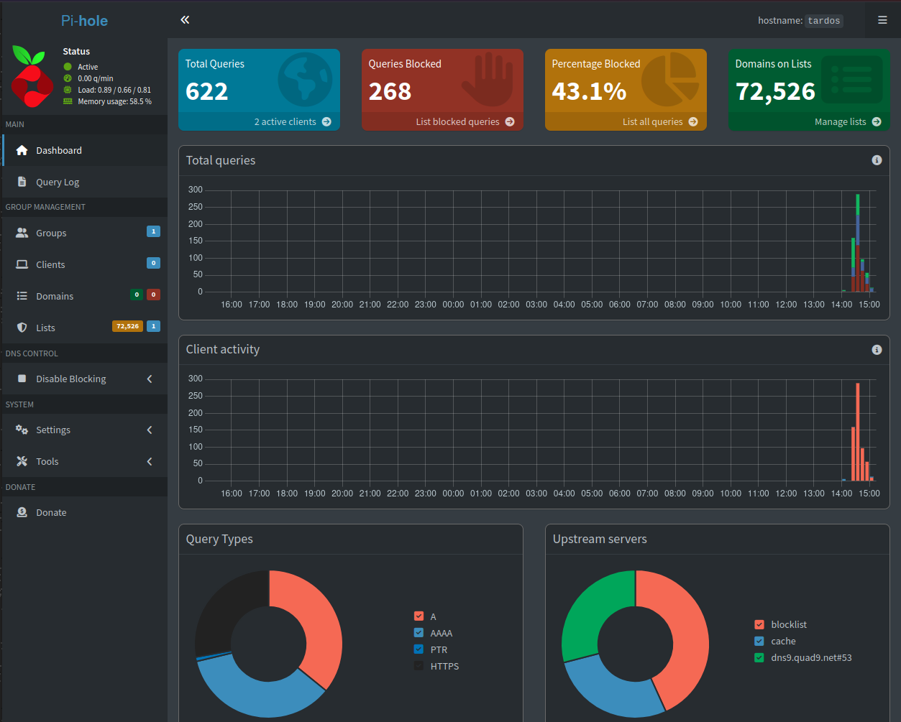
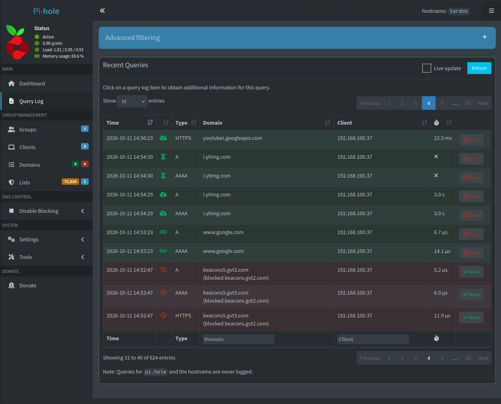

# Pi-hole Home Lab

A network-level ad and tracker blocker running on an old laptop, set up as my first always-on home server.



## What it does

[Pi-hole](https://pi-hole.net/) acts as a DNS server. When a device asks "where is this website?", Pi-hole answers normally for regular sites and returns `0.0.0.0` ("nowhere") for known ad and tracking domains, so they never load. It works for any device on the network without installing an app on it.

Upstream lookups go to **Quad9 (filtered, DNSSEC)**, which adds a second layer that blocks known malicious domains and verifies that DNS answers haven't been tampered with.

## Setup

| Part | Details |
| --- | --- |
| Hardware | Old Asus laptop (dual-core Pentium, 4 GB RAM) |
| OS | Linux Mint XFCE |
| Network | Wi-Fi, home fibre router (provider-managed) |
| Pi-hole | Installed with the official installer |
| Upstream DNS | Quad9 (filtered, DNSSEC) |
| Clients | My Android phone (per-device DNS) |

## How I built it

### 1. Turning a laptop into a server

A server has to stay on, so I stopped the laptop from sleeping when the lid closes:

- Power Manager: on AC power, closing the lid only turns off the display, and system sleep is set to never
- `/etc/systemd/logind.conf`: `HandleLidSwitch=ignore` and `HandleLidSwitchExternalPower=ignore`, then `sudo systemctl restart systemd-logind`

I confirmed it worked by pinging the laptop from my phone with the lid closed.

### 2. Installing Pi-hole safely

Instead of piping the install script straight into `bash`, I downloaded it and looked through it first:

```bash
wget -O basic-install.sh https://install.pi-hole.net
less basic-install.sh
sudo bash basic-install.sh
```

Choices during setup: Wi-Fi interface (`wlp3s0`), Quad9 filtered with DNSSEC, default blocklist, query logging on.

### 3. Testing that blocking works

```bash
nslookup doubleclick.net 127.0.0.1   # returns 0.0.0.0 -> blocked
nslookup wikipedia.org 127.0.0.1     # returns a real address -> allowed
```

Both queries then appeared in the dashboard, one marked as blocked.

### 4. Pointing a device at Pi-hole

I set my phone's Wi-Fi to a static configuration with the laptop as its only DNS server, and turned off Android's Private DNS, which would otherwise bypass Pi-hole. Queries from the phone appeared in the dashboard as soon as I started browsing.

After a short test session with one phone: 622 queries, 268 blocked (43.1%), using the default blocklist of about 72,500 domains.



The log shows allowed, cached and blocked lookups. Cached answers return in about 10 µs, while lookups forwarded to Quad9 take around 100 ms, so caching makes repeat lookups about 10,000 times faster.

The blocked `beacons5.gvt3.com` entries show CNAME blocking: the domain isn't on the blocklist itself, but it is an alias for `beacons.gvt2.com`, which is. Pi-hole follows the alias and blocks it.

A few `i.ytimg.com` lookups took 3 seconds or timed out, which matches the weak Wi-Fi signal described below.

## Problems and how I solved them

**The router's admin panel was locked.** The login printed on the router's label didn't work, even after a factory reset. The router runs the internet provider's firmware and is managed remotely, so the provider re-applies its own settings and password after a reset. Without router access I couldn't make Pi-hole the DNS server for the whole network, so I configured DNS per device instead. That was enough for testing and only affects my own devices.

**High latency with the lid closed.** Pinging the laptop from my phone averaged about 49 ms with the lid open and 100–120 ms with it closed. Inside a home network this should be under 10 ms. The causes were a weak Wi-Fi signal (the laptop is far from the router) and Wi-Fi power saving. It's acceptable for one device, because Pi-hole caches answers. The proper fix is to move the laptop next to the router and use an Ethernet cable before adding more devices.

**The laptop's address could change.** The router assigns the laptop's IP automatically, and I can't reserve it without router access. If the address changes, devices using Pi-hole lose DNS. For now I check it with `hostname -I` if anything stops working.

## What I learned

- How DNS resolution works, and how blocking at the DNS level works
- Running a background service on Linux and managing it from a web dashboard
- Measuring network latency with `ping` and reasoning about the causes
- Testing DNS directly with `nslookup`
- Why you should read install scripts before running them
- How provider-managed equipment limits what you can configure, and how to work around it

## Next steps

- [ ] Move the laptop next to the router and connect it with Ethernet
- [ ] Get router access from the provider and set Pi-hole as the DNS server for the whole network
- [ ] Reserve a fixed IP address for the laptop
- [ ] Add [Unbound](https://docs.pi-hole.net/guides/dns/unbound/) as my own recursive DNS resolver
- [ ] Review the query log for which apps contact tracking domains most
